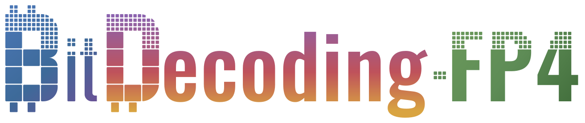
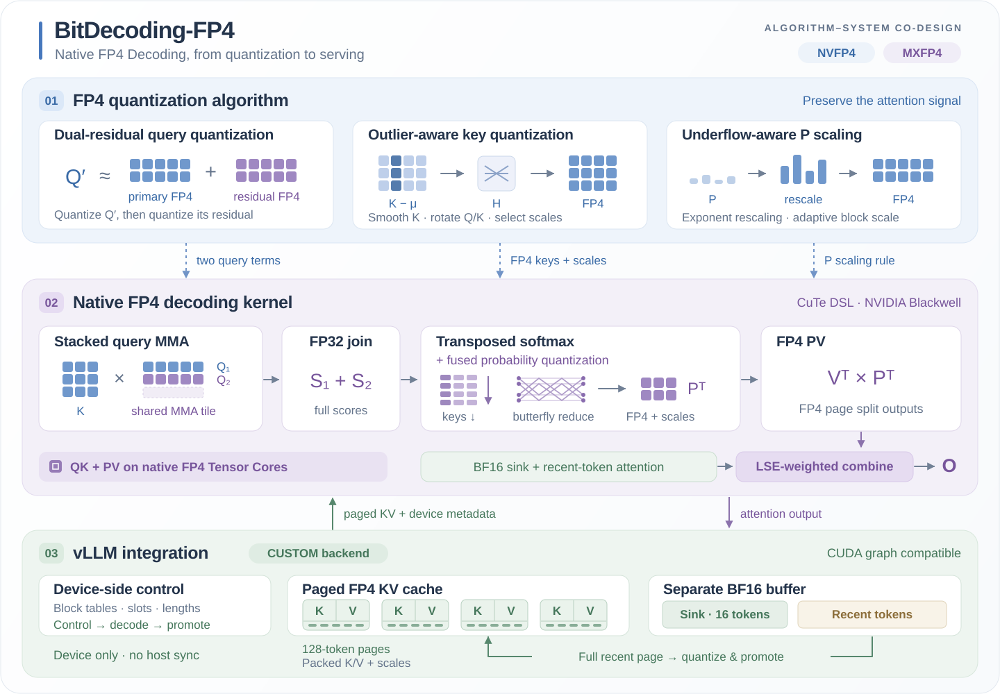
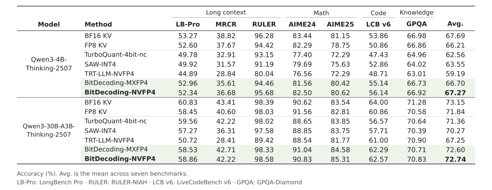
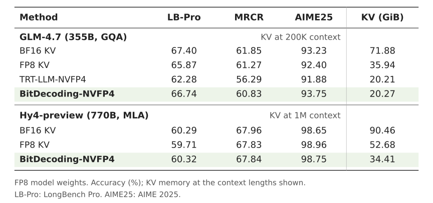
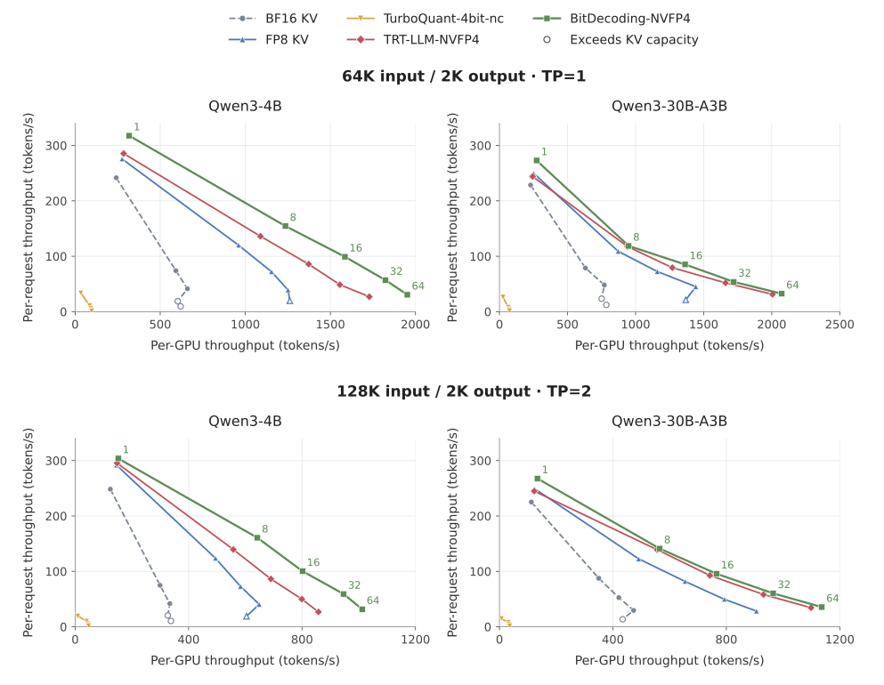

<p align="center">
  
</p>

BitDecoding-FP4 delivers accurate, high-performance LLM decoding through
**algorithm-system co-design**, combining **FP4 KV-cache quantization** with
native FP4 attention kernels. It integrates into vLLM as an out-of-tree `CUSTOM`
backend.

## Overview



## Loss-less Accuracy

BitDecoding-NVFP4 achieves **near-lossless accuracy**: across seven benchmarks,
the average score stays within **0.5 percentage points of BF16 KV** on
Qwen3-4B-Thinking-2507 and Qwen3-30B-A3B-Thinking-2507.



Results on larger FP8-weight models:



## Higher Serving Throughput.

On **NVIDIA B300**, BitDecoding-NVFP4 delivers **3.00×** (Qwen3-4B) and
**2.62×** (Qwen3-30B-A3B) the BF16 KV throughput:



> Concurrency: 1, 8, 16, 32, 64.

## Setup

### Requirements

- 1 × NVIDIA B200 or B300 GPU (SM100 / SM103)
- CUDA 13.0 or newer (NVIDIA driver 580+)
- Python 3.12 and [uv](https://docs.astral.sh/uv/) (`pip install uv`)

### Install

```bash
git clone --recurse-submodules https://github.com/OpenBitSys/BitDecoding-FP4.git
cd BitDecoding-FP4
bash tools/bootstrap_env.sh
```

All the required packages are then installed in `_local/envs/bd_fp4`.

## Benchmark

See the [performance benchmark guide](benchmark/README.md) for kernel and e2e-serving options.

## Evaluation

See the [accuracy evaluation guide](evaluation/README.md) for dataset installation and the evaluation benchmarks used in the paper.

## License

Original code is licensed under the [MIT License](LICENSE).
Third-party components retain their own licenses; see [NOTICE](NOTICE).
